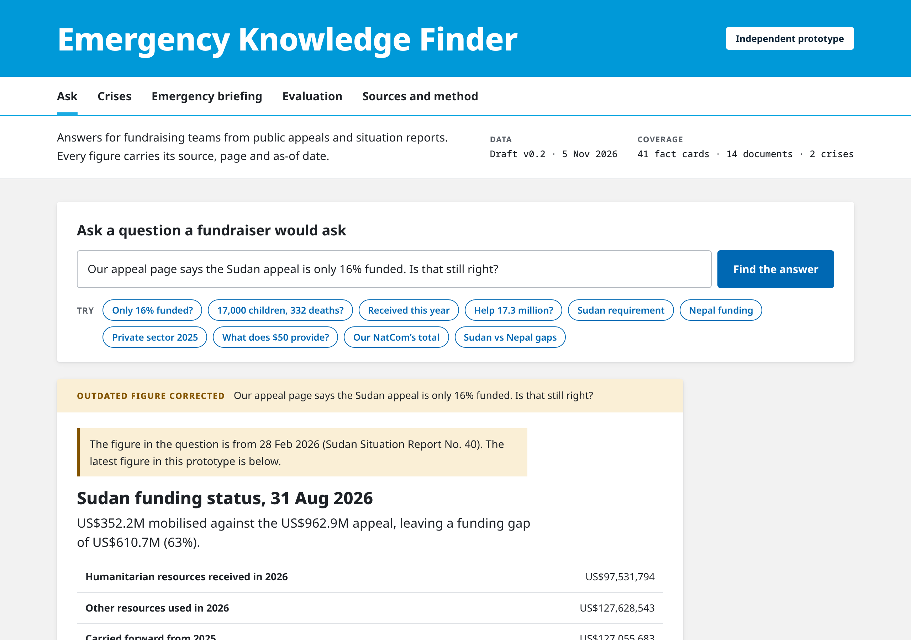
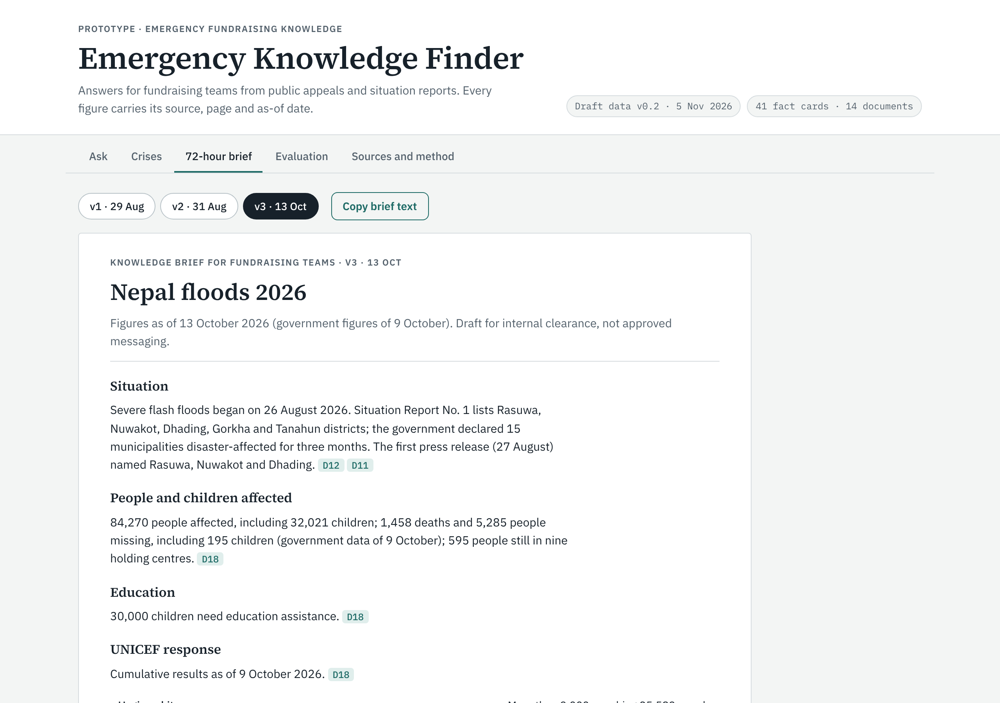

# Emergency Knowledge Finder

A working prototype of a search and governance layer for emergency fundraising knowledge. A fundraiser asks a question in plain English and gets the current, source-of-record figure with its as-of date, page reference and a link to the document it came from. If the question relies on an outdated figure, the prototype corrects it. If the answer depends on a definition, it asks which one is meant. If the public evidence cannot support an answer, it says so and points to who can help.

It is built from public UNICEF documents about two emergencies: the crisis in Sudan (the 2026 Humanitarian Action for Children appeal and situation reports) and the 2026 flash floods in Nepal.

> **Independent portfolio prototype.** Not a UNICEF product, and not affiliated with or endorsed by UNICEF. Draft data v0.2 (5 November 2026): every figure has been re-checked against its source, and final review is in progress. Check the linked source before using any figure.



## The problem

In the first days of an emergency, fundraisers in National Committees and country offices all need the same few facts: how many children are affected, what UNICEF is appealing for, how much has been raised and what the money will do. Those figures change with every situation report. Older numbers keep circulating in decks, appeal pages and emails, and terms that sound alike mean different things: "mobilised" is not "received", and "children in need" is not "children UNICEF aims to reach".

This prototype explores one way to deal with that. It is designed to sit on top of the repositories a fundraising team already uses (such as SharePoint sites and the WeShare asset library), not to replace them. It adds what those repositories lack on their own:

- a register of which document is the source of record for each kind of figure;
- a status for every figure: current, superseded, initial or variant;
- search that respects both, so an older figure is never returned as the answer.

## What is in the app

| View | What it shows |
|---|---|
| **Ask** | Type a question or pick an example. The answer gives the figure, the date of the data, the source document with its date and page, the date the sources were last checked, its status, and the behaviour the prototype chose. A question about two crises is answered in two parts. |
| **Crises** | One page each for Sudan, the Nepal floods and the global picture: a situation-in-numbers panel and funding bar, the latest figures in this prototype with dates and sources, how key figures changed over time, and variants and update checks. |
| **Emergency briefing** | A brief on the Nepal floods for fundraising teams: the initial 72-hour brief (29 Aug 2026) and two updates (31 Aug and 13 Oct). Each version opens with what to do next: what changed, which existing materials to review, what still needs verifying, and next steps, including who clears the text. It can be copied as plain text with its sources, dates and draft status. |
| **Evaluation** | The 30 evaluation questions, run live in the page, with the result for each. |
| **Sources and method** | How answers are produced, the scope and data rules, limitations and the document list. |



## How it answers

Every answer carries one of nine behaviours.

| Behaviour | When it is used | Example question |
|---|---|---|
| `ANSWER` | A current figure answers the question. | "Which five 2026 appeals have the largest funding requirements?" |
| `ANSWER_CALC` | The answer needs a calculation from published figures. The formula and inputs are shown and labelled as a calculation. | "What share of UNICEF's 2026 global appeal is for Sudan?" |
| `ANSWER_FLAG` | A current figure exists but needs a caveat: documents differ slightly, an update is overdue, or the figure belongs to another agency. | "What is the total 2026 funding requirement for Sudan?" |
| `CORRECT_PREMISE` | The question quotes a figure that has been superseded. The answer shows what the earlier source said and the latest figure. | "Our appeal page says the Sudan appeal is only 16% funded. Is that still right?" |
| `ANSWER_PERIOD` | The question asks about one earlier month. The answer gives the figure for that month and shows the latest one beside it. | "What was Sudan's funding gap in February 2026?" |
| `CLARIFY_DEFINITION` | The honest answer depends on which definition is meant. | "How much money has UNICEF received for Sudan this year?" |
| `ABSTAIN` | The public documents hold no evidence for the claim, such as per-gift impact or a forecast. | "What does a $50 gift provide for families hit by the Nepal floods?" |
| `REFUSE_ROUTE` | The answer is held in internal systems. The prototype says where to ask instead. | "Which photos and key messages are cleared for our Sudan campaign?" |
| `MULTI_PART` | The question names two crises. Each is answered separately, and the answer says plainly if one part has no evidence. Funding figures on different bases carry a warning. | "Compare the funding gaps for Sudan and Nepal" |

## How it works

- **Read the question first.** Before a card is chosen, the prototype checks what is asked: one named month favours figures from that month (and a month with no figure is said so plainly), a calculated change between two dates cannot answer a question about one month, and "how many" or "how much" needs a card that holds figures. Any question about money "received" for Sudan gets the received/mobilised definition check.
- **Fact cards, not whole documents.** The prototype searches 41 fact cards. Each card holds one figure or fact with its source document, page, as-of date and status. Cards about the same item form a group, and the group decides which figure is current.
- **Keyword ranking (BM25)** with a light stemmer, synonyms and a stopword list. When a question names a crisis, cards from that crisis rank higher and cards from the other crisis lower; global cards are not affected.
- **Premise check.** Numbers in the question are compared with the figures in the matching group. A number that matches a superseded figure but not the current one triggers a correction.
- **Definition checks.** Some cards carry clarification triggers. For example, a question about money "received" "this year" for Sudan gets the received figure, with an explanation of how it differs from the larger "mobilised" total.
- **Labelled calculations.** Derived figures show their formula and inputs.
- **Update checks.** A card can record when the next report is due, and the answer is flagged once that date has passed.
- **"Latest" means latest in this prototype.** Each answer separates the date of the data, the date of the source document and the date the sources were last checked for newer reports (5 November 2026), because a newer report may have been published since.
- **Questions about two crises** are answered once per crisis, so a partial answer cannot pass as a complete one.
- **Scope rules** stop the prototype from answering four kinds of question that public documents cannot support: a National Committee's own campaign results, cleared messages and images, per-gift impact, and forecasts. The per-gift rule looks for what money buys ("What does a $50 gift provide?"), not for an amount or the word "donation" on its own, so "Is the Sudan appeal US$962.9 million?" and "How much donation funding has UNICEF received for Sudan?" are answered. When a question is refused, the nearest fact shown is a published figure, not a calculation.
- **No language model writes the answers** in this version. Every number shown comes from a card checked against its source.

The logic is in [`src/engine.js`](src/engine.js) (data, search and answer rules) and the interface in [`src/ui.js`](src/ui.js).

## Evaluation

[`eval/`](eval/) holds 30 questions written the way a fundraiser would ask them, from four roles: National Committee digital and partnerships staff, the PFP emergency fundraising team, and country office private sector fundraisers. Twenty are normal questions. Ten are traps, two of each type:

| Trap | What it tests |
|---|---|
| T1 Stale | The question relies on a superseded figure. |
| T2 No evidence | The claim has no support in the documents. |
| T3 Variant | Documents give slightly different figures for the same thing. |
| T4 Definition | The answer depends on which definition is meant. |
| T5 Internal | The answer is held in internal systems only. |

Five reserve questions (R1 to R5) test the same behaviours with new questions. They were also seen during development.

| Check | Result |
|---|---|
| Follows the expected behaviour | 30 of 30 |
| Cites an expected source | 30 of 30 |
| Strict: every figure in the gold answer shown with its value and unit, each from a fact card that cites an expected document, with the gold as-of date | 30 of 30 |
| Reserve questions: follows the expected behaviour | 5 of 5 |
| Regression checks for issues found in two reviews (6 November 2026) | 11 of 11 |
| Scorer checks: answers broken on purpose that the strict scorer must fail | 8 of 8 |

**Read these results with care.** The rules and cards were tuned on these same questions, so the scores show that the prototype works as designed, not how it handles new questions. A held-out set, with questions written independently of the rules and questions gathered from interviews with fundraisers, will be scored before any results are claimed. The source check counts an answer as correct when it cites at least one expected source. The strict check goes further: each question has a list of claims taken from its draft gold answer in [`eval/questions_v0.2.csv`](eval/questions_v0.2.csv), with the documents each claim must come from. An answer passes only if it has the expected behaviour, shows every claim, shows each claim from a fact card that cites one of that claim's documents, and carries the gold as-of date. Figures are compared as values with their currency and unit, so 63% does not match 163% and US$1.1 million does not match US$351.1 million; other claims are matched as whole phrases.

What the strict check does not do: it compares the page with the fact cards, not with the source documents. "Cited" means the card that shows the figure cites an expected document; that each card matches its source was checked by hand (see the re-check column in the CSV). It also confirms that a figure is shown, not that the sentence around it is worded correctly; wording is reviewed by hand in the workbook.

The scorer is tested too. `run_eval.js` breaks eight answers on purpose (a gap changed from 63% to 163%, US$352.2M changed to US$352.25M, a missing figure, the wrong month, a missing earlier figure, a dropped caveat, a figure credited to the wrong document) and fails if the strict scorer passes any of them. The first two passed the earlier substring-based scorer.

Run the evaluation with `node eval/run_eval.js` (or `npm test`).

## Metadata and governance

[`schema/`](schema/) defines the metadata that makes each answer checkable:

- [`figure.schema.json`](schema/figure.schema.json) (JSON Schema 2020-12): 28 fields for one published figure, including value, unit, qualifier, as-of date, source document and location, a short source quote, calculation basis, status, source-of-record flag, authority rank, what it supersedes and, for calculated figures, how it was derived.
- [`document.schema.json`](schema/document.schema.json): 22 fields for each source document, including type, crisis, publication date, status, what it is the source of record for, its content owner, what triggers a review and how it may be stored.
- [`controlled-lists.json`](schema/controlled-lists.json): the allowed values for crisis, document type, metric type, qualifier, status, authority rank, role and task moment, each with a definition.
- [`source-of-record-rules.md`](schema/source-of-record-rules.md): which document is the authority for each kind of figure, and how newer or conflicting figures are handled.

[`data/corpus.csv`](data/corpus.csv) is the document register: 23 documents, 22 of them with a public link (one Executive Board document could not be found online). The documents themselves are not stored here. The workbook in [`eval/`](eval/) holds the questions, schemas and rules on separate sheets, with columns for the reviewer's sign-off.

## Repository layout

```
docs/index.html     the built app: one self-contained page, also served by GitHub Pages
docs/img/           screenshots used in this README
src/                app source: engine.js, ui.js, head.html, body.html
scripts/build.js    assembles docs/index.html from src/
eval/               evaluation questions (CSV and workbook) and run_eval.js
schema/             JSON Schemas, controlled lists and source-of-record rules
data/corpus.csv     document register (links only)
```

## Running it

Open `docs/index.html` in a browser. There is nothing to install.

After editing anything in `src/`, rebuild the page and run the evaluation again:

```
node scripts/build.js
node eval/run_eval.js
```

Both need Node.js 18 or later and no other packages. GitHub Actions runs the same steps on every push and fails if a question no longer gets its expected behaviour and source, or if `docs/index.html` is out of date.

To publish the app with GitHub Pages, go to Settings, then Pages, choose "Deploy from a branch", and select `main` and the `/docs` folder. On a free GitHub plan, Pages works only for public repositories.

## Data rules

- Public documents only. The app shows short facts with page references and links to the original documents. It does not store or redistribute UNICEF files.
- No UNICEF logo or branded material.
- Differences between documents are described as variants, not errors.
- Funding totals in situation reports describe appeal funding. They are not fundraising campaign results.

## Limitations

- Draft data v0.2: figures were re-checked against their sources on 5 November 2026, and final human review is in progress. Page references for six questions still need confirming against the UNICEF-hosted copy of the Sudan appeal.
- Two crises and 14 documents so far.
- Keyword search only. A question worded very differently from the cards may not find the right one; the prototype then abstains rather than guess.
- The evaluation questions were also used to develop the rules (see above).

## How it was built

The author set the brief, scope and evaluation approach and is reviewing every figure before release. Claude (Anthropic) drafted the code, evaluation questions and schemas and re-checked each figure against its source document. Other AI models reviewed the concept and the evaluation design.

## Licence

The code is released under the MIT licence (see [LICENSE](LICENSE)). Figures and short quotations come from public UNICEF documents and remain subject to UNICEF's terms of use; this repository links to those documents rather than copying them.

Prototype by Jeerana Noymanee.
